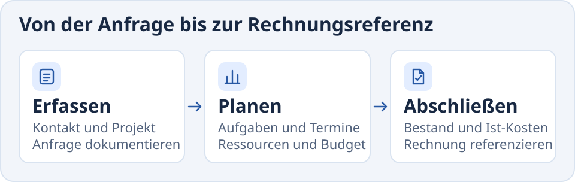

<picture>
  <source media="(prefers-color-scheme: dark)" srcset="docs/marke/desk-logo-dunkel.svg">
  
</picture>

# Den ganzen Auftrag im Blick.

**Desk ist Projektverwaltung für kleine Teams, die Kundenaufträge auf dem eigenen Server organisieren.** Du erfasst Anfragen, planst Aufgaben, Personal und Material und behältst Lagerbestand und Projektkosten im Blick. Der Ablauf reicht vom ersten Kontakt bis zur dokumentierten Rechnungsreferenz.

<picture>
  <source media="(prefers-color-scheme: dark)" srcset="docs/marke/desk-auftragsablauf-dunkel.svg">
  
</picture>

[Warum Desk?](#warum-desk) · [Auftragsablauf](#so-läuft-ein-auftrag) · [Funktionen](#funktionen) · [Haben und Zammad](#haben-und-zammad) · [Schnellstart](#schnellstart) · [FAQ](#häufige-fragen)

> [!NOTE]
> Desk 0.1.0.0 ist veröffentlicht. Das Quellarchiv und seine SHA-256-Prüfsumme stehen unter **Assets** bereit. [Download und Release-Notizen](https://github.com/Vemoro/desk/releases/tag/v0.1.0.0) · [Produktseite und Dokumentation](https://vemoro.de/desk/) · [Roadmap](docs/roadmap.md)

## Warum Desk?

Ein bestätigtes Angebot ändert die Planung. Welche Aufgaben sind offen? Wer ist verfügbar? Welches Gerät ist noch frei? Welche Belege gehören zum Auftrag? In Desk arbeitest du mit diesen Informationen am selben Projekt. In der Wochenplanung siehst du zusätzlich, welche Ressourcen projektübergreifend vorgemerkt oder fest gebucht sind.

Angebote und Rechnungen entstehen in Haben oder deinem Abrechnungssystem. Desk verwaltet die operative Projektarbeit und hält die zugehörigen Referenzen am Auftrag fest. Haben und Zammad kannst du je nach Bedarf anbinden.

## So läuft ein Auftrag

1. **Anfrage aufnehmen.** Lege Kontakt und Projekt an. Desk weist auf mögliche Kontaktdubletten hin und zeigt zugehörige Projekte im Kontaktdetail.
2. **Auftrag vorbereiten.** Verteile Aufgaben im Kanban, merke Personal und Inventar vor und kalkuliere Einkauf und Verkauf. Übergib Verkaufspositionen bei Bedarf als CSV an die Angebotserstellung.
3. **Ressourcen fest buchen.** Erfasse die Auftragsbestätigung von Hand oder lies den Status eines verknüpften Haben-Angebots ein. Bei festen Reservierungen prüft Desk zeitliche Konflikte für Personal und Geräte sowie die verfügbare Menge am Lagerort.
4. **Ausführen und abschließen.** Erfasse Materialausgaben, Rückgaben und Verbrauch. Ordne Belege zu, vergleiche Ist-Kosten mit der Kalkulation und hinterlege die Rechnungsreferenz.

In der Demo durchläuft der fiktive **Muster Auftragsservice** denselben Ablauf mit zwei Aufträgen. Für eine Büroinstallation plant das Team Montage und Material. Bei einer Veranstaltungsbetreuung koordiniert es Personal und Technik. Beide verwenden dieselben Projektzustände und dieselbe Lagerlogik. [Beide Musteraufträge im Test](e2e/core.spec.ts) · [Ansichten der Anwendung](docs/desk.md#ansichten)

## Funktionen

| Bereich | Was du in Desk erledigst |
| --- | --- |
| **CRM und Projekte** | Kontakte verwalten, Projekte zuordnen und Angebots- und Rechnungsreferenzen pflegen. Statuswechsel und Lagerbewegungen im Projektverlauf nachschlagen. |
| **Kanban und Wochenplanung** | Aufgaben zuweisen und terminieren. Personal- und Inventarreservierungen projektübergreifend ansehen. |
| **Kalkulation** | Einkauf und Verkauf getrennt planen. Mengen, Einzelpreise und Verkaufspositionen für die Angebotsübergabe erfassen. |
| **Projektlager** | Physischen, reservierten und freien Bestand je Lagerort prüfen. Wareneingang, Ausgabe, Rückgabe und Verbrauch buchen. Einzelgeräte über Inventarnummern unterscheiden. |
| **Controlling** | Geplante Einkaufskosten mit belegbezogenen Ist-Kosten vergleichen. Kosten per Referenz zuordnen oder als CSV übernehmen. |
| **Team und REST-API** | Rollen für Administration und Mitarbeit vergeben. Mit Passwort oder Passkey anmelden. Die versionierte API mit widerrufbaren Lese- oder Schreib-Tokens verwenden. |

[Projektverlauf](docs/desk.md#projektverlauf-ansehen) · [Wochenplanung](docs/desk.md#wochenplanung-öffnen) · [Navigation am Smartphone](docs/desk.md#navigation-am-smartphone)

## Haben und Zammad

| Anbindung | Zusammenspiel |
| --- | --- |
| **Haben** | Angebote und Rechnungen entstehen in Haben. Desk liefert Verkaufspositionen als CSV, liest den Status vorhandener Angebote ein und kann einzelne verknüpfte Kontakte auf Anstoß in beide Richtungen abgleichen. |
| **Zammad** | Ein Ticket neu anlegen oder verknüpfen, den Verlauf im Projekt lesen und Antworten mit PDF-Anhang über Zammad versenden. |
| **Eigenständiger Betrieb** | Desk führt Projekte, Kalkulation, Lager und Controlling mit manuellen Referenzen weiter. Vorgangslinks und Kommunikationsnotizen bleiben am Projekt. |

[Haben](https://haben.app/) · [Haben-Anbindung in Desk](docs/desk.md#haben) · [Zammad-Anbindung in Desk](docs/desk.md#zammad)

## Schnellstart

Du brauchst die in `package.json` angegebene Bun-Version und PostgreSQL. Docker Compose kann die lokale Entwicklungsdatenbank starten.

1. Im Repository `docker compose up -d db` ausführen.
2. `.env.example` als `.env` kopieren. `DATABASE_URL` prüfen und `DESK_AUTH_SECRET` mit einem zufälligen Wert aus mindestens 32 Zeichen belegen.
3. `bun install --frozen-lockfile` und danach `bun run migrate` ausführen.
4. Ein eigenes Passwort als Umgebungsvariable `DESK_ADMIN_PASSWORD` setzen. Das Konto mit `bun run admin admin@example.test "Desk Admin"` anlegen.
5. `bun run dev --port 5173 --strictPort` starten und `http://localhost:5173` öffnen. Bei einem anderen Port `DESK_ORIGIN` an die Browseradresse anpassen.

Die Betriebsdoku führt durch den Containerbetrieb und die drei Installationswege mit neuer Zammad-Instanz, mit bestehender Instanz oder ohne Zammad. [Betrieb](docs/desk.md#betrieb) · [Installationswege](docs/installation.md) · [Demo-Daten und Screenshots](docs/entwicklung.md#befehle-und-screenshot-workflow)

## Häufige Fragen

**Kann ich Desk für verschiedene Auftragstypen einsetzen?**

Ja. Desk verwendet einen gemeinsamen Projektablauf. Du legst Kontakte, Aufgaben, Termine, Ressourcen und Lagerorte passend zu deinem Team an.

**Kann ich Angebote und Rechnungen aus Desk erstellen?**

Du erstellst sie in Haben oder in deinem Abrechnungssystem. In Desk kalkulierst du die Positionen, exportierst die Verkaufskalkulation und hältst den Angebotsstatus und die Rechnungsreferenz fest.

**Wo finde ich die Schnittstellenbeschreibung?**

In einer laufenden Desk-Instanz unter `/api/v1/openapi.json`. Die Betriebsdoku beschreibt auch die Seitennavigation der API. [REST-API](docs/desk.md#seitennavigation-der-rest-api)

## Mitwirken

Desk steht unter der AGPL-3.0-only. Du kannst Fehler melden, Vorschläge einbringen oder einen Beitrag vorbereiten. [Mitwirken](CONTRIBUTING.md) · [Sicherheitsmeldungen](SECURITY.md) · [Entwicklungsregeln](docs/entwicklung.md) · [Lizenz](LICENSE) · [Urheberhinweis](public/desk-notice.txt) · [Lizenzinventar der Auslieferung](docs/lizenzinventar.md) · [Drittanbieterhinweise](public/third-party-notices.txt)
