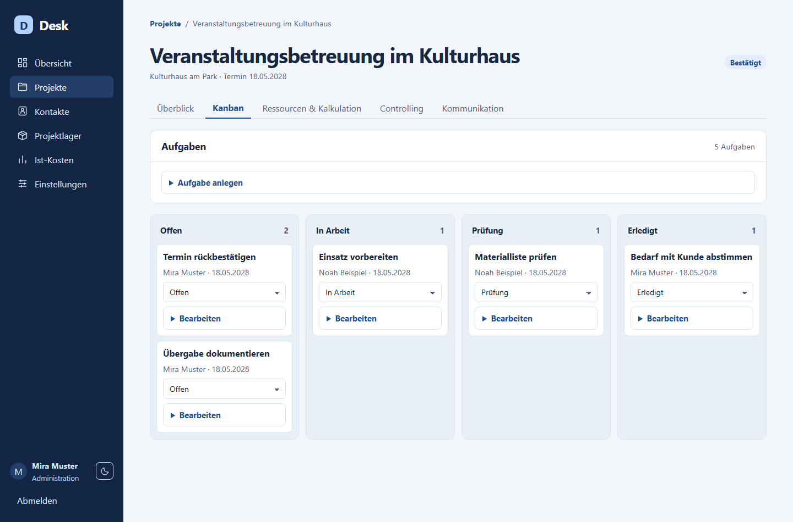
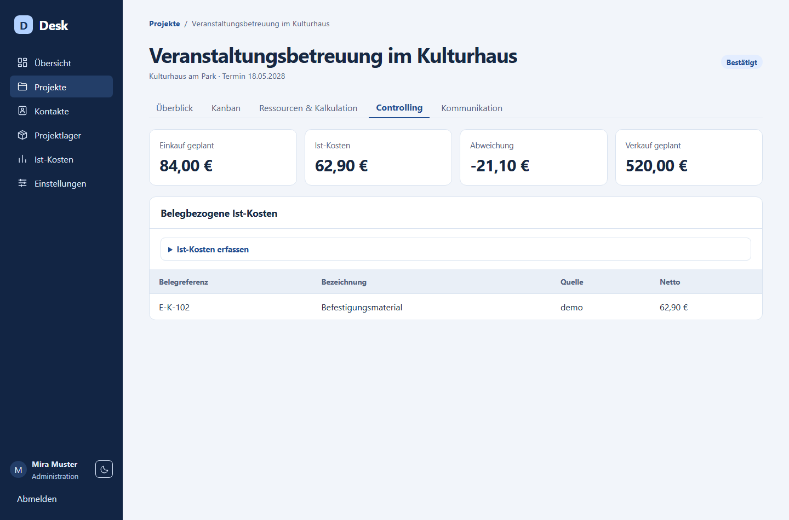

# Desk

**Projektverwaltung für kleine Teams auf dem eigenen Server.** Desk verbindet CRM, Kanban, Ressourcenplanung, Kalkulation und Projektlager. Von der Anfrage bis zur Rechnungsreferenz bleibt der Auftrag an einem Ort.

[Funktionen](#funktionen) · [Anbindungen](#anbindungen) · [Schnellstart](#schnellstart) · [Betriebsdoku](docs/desk.md) · [Mitwirken](CONTRIBUTING.md)

<picture>
  <source media="(prefers-color-scheme: dark)" srcset="docs/screenshots/kanban-dunkel.png">
  
</picture>

*Kanban im Beispielprojekt des fiktiven Muster Auftragsservice.*

> [!NOTE]
> Desk befindet sich in Entwicklung. Die Freigabe der ersten Version ist in Vorbereitung. [Roadmap](docs/roadmap.md) · [Release-Abnahme](docs/release-abnahme.md)

## Wie ein Auftrag in Desk läuft

Ein neuer Auftrag beginnt mit einem Kontakt und einem Projekt. Das Team verteilt Aufgaben, plant Personal und Material und kalkuliert Einkauf und Verkauf. Nach der Auftragsbestätigung lassen sich Ressourcen verbindlich buchen. Im Projekt bleiben Lagerbewegungen, zugeordnete Belege und die Referenzen zu Angebot und Rechnung sichtbar.

## Funktionen

| Bereich | Was du in Desk erledigst |
| --- | --- |
| CRM und Projekte | Kontakte erfassen, Projekte zuordnen und Auftragsstatus sowie Angebots- und Rechnungsreferenzen pflegen. |
| Kanban und Termine | Aufgaben in vier Spalten bearbeiten, Verantwortliche zuweisen und Termine festhalten. |
| Ressourcenplanung und Kalkulation | Personal und Inventar vormerken, Ressourcen fest buchen und Einkaufs- und Verkaufspositionen erfassen. |
| Projektlager | Physischen, reservierten und freien Bestand je Lagerort prüfen. Wareneingang, Ausgabe, Rückgabe und Verbrauch erfassen. |
| Controlling | Geplante Einkaufskosten und zugeordnete Ist-Kosten vergleichen. Belege per Referenz zuordnen oder aus CSV übernehmen. |
| Teamkonten | Administratoren und Mitarbeitende melden sich mit Passwort oder eigenen Passkeys an. |
| REST-API | Kernressourcen über widerrufbare Tokens nutzen. In der laufenden Instanz ist die OpenAPI-Beschreibung unter `/api/v1/openapi.json` erreichbar. |

## Anbindungen

Desk unterstützt Projektarbeit, Kalkulation, Lager und Controlling eigenständig. Haben und Zammad lassen sich je nach Arbeitsablauf ergänzen.

| Anbindung | Zusammenspiel |
| --- | --- |
| Haben | In [Haben](https://haben.app/) Angebote und Rechnungen erstellen. Desk liefert Verkaufspositionen als CSV, verknüpft vorhandene Angebote und liest deren Status ein. Kontakte lassen sich in beide Richtungen abgleichen. Angebotsbestätigung und Referenzen können auch von Hand gepflegt werden. |
| Zammad | Ein Ticket anlegen oder verknüpfen. Der Verlauf erscheint im Projekt, Zammad versendet Antworten. Ohne Anbindung lassen sich Vorgangslink und Kommunikationsnotiz am Projekt pflegen. |

Weitere Angaben zu Konfiguration und Berechtigungen stehen in der Betriebsdoku. [Haben](docs/desk.md#haben) · [Zammad](docs/desk.md#zammad)

## Schnellstart

Du brauchst die in `package.json` angegebene Bun-Version sowie PostgreSQL. Für die lokale Entwicklungsdatenbank kannst du Docker Compose verwenden.

1. Im Repository `docker compose up -d db` ausführen.
2. `.env.example` als `.env` kopieren. `DATABASE_URL` prüfen und `DESK_AUTH_SECRET` mit einem zufälligen Wert aus mindestens 32 Zeichen belegen.
3. `bun install --frozen-lockfile` und danach `bun run migrate` ausführen.
4. Ein eigenes Passwort als Umgebungsvariable `DESK_ADMIN_PASSWORD` setzen. Das Konto mit `bun run admin admin@example.test "Desk Admin"` anlegen.
5. `bun run dev` starten und `http://localhost:5173` öffnen. Bei einem anderen Port `DESK_ORIGIN` an die Browseradresse anpassen.

Hinweise zu Build, Container, HTTPS und Sicherung stehen in der Betriebsdoku. [Installation und Betrieb](docs/desk.md#betrieb)

## Einblick in die Demo

<picture>
  <source media="(prefers-color-scheme: dark)" srcset="docs/screenshots/controlling-dunkel.png">
  
</picture>

Das Controlling zeigt hier einen Beleg und seinen Anteil an den Ist-Kosten des Musterauftrags. Beispiele für das Projektlager auf dem Smartphone und die Anleitung zum Erzeugen der Bilder stehen in der Doku. [Weitere Ansichten](docs/desk.md#ansichten) · [Demo und Screenshots](docs/entwicklung.md#befehle-und-screenshot-workflow)

## Mitwirken

Die Beitragsrichtlinien erklären, wie du Fehler meldest, Vorschläge einbringst und Änderungen vorbereitest. Desk steht unter der AGPL-3.0-only. [Mitwirken](CONTRIBUTING.md) · [Entwicklungsregeln](docs/entwicklung.md) · [Lizenz](LICENSE)
