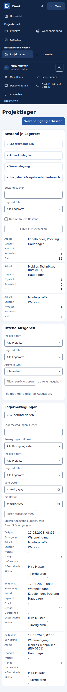

# Desk verwenden und betreiben

## Desk als Web-App installieren

Öffne die HTTPS-Adresse deiner Desk-Instanz. Wähle in Chrome oder Edge unter Windows die Installationsaktion in der Adressleiste oder im Browsermenü. In Chrome unter Android findest du sie im Browsermenü. Öffne unter iOS das Teilen-Menü in Safari, wähle **Zu Home-Bildschirm hinzufügen**, aktiviere **Als Web-App öffnen** und tippe auf **Hinzufügen**.

Starte Desk danach über das blaue Desk-Symbol im Startmenü oder auf dem Home-Bildschirm und melde dich wie gewohnt an. Die installierte App benötigt eine Verbindung zu deiner Desk-Instanz.

## Ein Auftrag

Die Kennzahl **Überfällige Aufgaben** in der **Übersicht** zählt alle offenen Aufgaben aktiver Projekte mit einem Termin vor dem heutigen Kalendertag des Browsers. Sie aktualisiert sich beim Tageswechsel und gilt unabhängig von den Filtern der Aufgabenliste.

In der **Übersicht** zeigt **Fällige Aufgaben** bis zu zehn offene Aufgaben mit Termin aus aktiven Projekten. Unter **Aufgaben anzeigen** wählst du **Alle**, **Mir zugeordnet** oder **Ohne Zuständigkeit**. Unter **Aufgabentermine filtern** wählst du **Alle Termine**, **Überfällig**, **Heute** oder **Später**. Beide Auswahlen greifen vor der Zehn-Zeilen-Grenze. Die Trefferzahl berücksichtigt alle passenden Aufgaben. Sind es mehr als zehn, zeigt Desk zum Beispiel **10 von 17 Aufgaben angezeigt**. Die ältesten Termine stehen zuerst. **Überfällig**, **Heute** und **Später** richten sich nach dem Kalendertag des Browsers. Beim Tageswechsel bleiben die Auswahlen gesetzt und die Aufgaben werden für den neuen Tag angezeigt. Verschwindet dabei eine Zeile mit Tastaturfokus, springt der Fokus zum Terminfilter. Wähle den Projektnamen in einer Zeile, um den Projektüberblick zu öffnen.

1. Einen Kontakt und ein Projekt anlegen. Aufgaben im Kanban verteilen und den Projektstatus auf Planung setzen.
2. Personal und Inventar vormerken. Das Ende einer Vormerkung muss nach dem Beginn liegen. Bei **Von** und **Bis** zeigt das Formular die Browser-Zeitzone für neue Eingaben. Geplante Einkaufskosten und Verkaufspositionen erfassen. **Einkauf netto** und **Verkauf netto** zeigen die jeweiligen Gesamtsummen des geöffneten Projekts direkt in der Kalkulation. Ohne Positionen stehen beide Summen auf 0,00 €. Unter **Angebotspositionen exportieren** prüfst du die Verkaufspositionen mit Menge und Netto-Einzelpreis. **CSV herunterladen** übernimmt die angezeigten Positionen in die Datei. Bei einem Abruffehler kannst du die Vorschau erneut laden. Beim Entfernen einer Kalkulationsposition zeigt Desk ihren Namen zur Bestätigung.
3. Eine Angebotsreferenz ergänzen. Bei eingerichteter Haben-Verbindung die ID des vorhandenen Angebots eintragen und abgleichen. Desk zeigt den Status des Angebots an und kann die Bestätigung übernehmen. Ohne Haben wird der Projektstatus von Hand gesetzt.
4. Nach der Bestätigung Ressourcen fest reservieren. Personen können sich in festen Reservierungen zeitlich nicht überschneiden. Bei Geräten prüft Desk die am Lagerort verfügbare Menge im gewählten Zeitraum, bei Verbrauchsmaterial alle festen Reservierungen am Lagerort. Eine Freigabe gibt die reservierte Menge frei. Die Reservierung bleibt mit dem Status „Freigegeben“ sichtbar. Bereits ausgegebene Geräte bleiben bis zur Rückgabe sichtbar.
5. Im Projektlager Wareneingang erfassen. Das Team kann fest reservierte Geräte im gebuchten Zeitfenster ausgeben und später zurücknehmen. Bei einer festen Reservierung kann es Verbrauchsmaterial ausbuchen. Die Bestandsübersicht zeigt bei Geräten die aktuell geltenden festen Reservierungen und bei Verbrauchsmaterial alle offenen festen Reservierungen. Unter **Offene Ausgaben** kannst du nach Projekt, Lagerort und Artikel filtern. Die Trefferzahl zählt die sichtbaren Ausgabezeilen. Nach einer Teilrückgabe steht in der Zeile die verbleibende Menge. Die Tabelle **Lagerbewegungen** zeigt den Lagerort jeder Buchung.
6. Ist-Kosten importieren oder per Belegreferenz zuordnen. Im Controlling stehen Netto-Plan- und Ist-Kosten nebeneinander. Den Auftrag über „In Durchführung“ fortsetzen. Die in Haben oder einem anderen System erstellte Rechnung im Projekt referenzieren und den Projektstatus auf „Abgerechnet“ setzen.

Im Projektüberblick unter **Auftrag und Abrechnung** zeigt Desk, welche Referenz für **Angebot** oder **Abgerechnet** noch fehlt. Trage sie ein und wähle **Referenzen speichern**, damit der Statuswechsel verfügbar wird. Eine bereits gespeicherte Haben-Angebots-ID genügt für **Angebot** auch bei deaktivierter Haben-Anbindung.

Unter **Kontakte → Kontakt anlegen** prüft Desk beim Speichern, ob der Name oder die ausgefüllte E-Mail-Adresse mit einem vorhandenen Kontakt übereinstimmt. Äußere Leerzeichen und Groß- oder Kleinschreibung spielen beim Vergleich keine Rolle. Öffne einen Treffer aus der Liste oder wähle **Trotzdem anlegen** und bestätige den zusätzlichen Kontakt. **Abbrechen** erhält die Eingabe und die Trefferliste.

Unter **Kontakte suchen** findest du Namen, E-Mail-Adressen und Rufnummern. Für die Rufnummernsuche kannst du einen Teil der Nummer eingeben. Desk vergleicht die Ziffern unabhängig von Leerzeichen, Pluszeichen, Klammern und Bindestrichen. Leerzeichen vor und nach dem Suchbegriff kannst du beim Einfügen stehen lassen. Bei einer Suche ohne Treffer zeigt **Suche leeren** wieder alle Kontakte. **Neuer Kontakt** öffnet das Formular aus dem Seitenkopf oder aus der leeren Liste.

Unter **Projekte** öffnet **Neues Projekt** das Projektformular. Ist noch kein Kontakt vorhanden, führt **Zu den Kontakten** zur Kontaktliste, wo du zuerst einen Kontakt anlegst.

Unter **Projekte** kannst du die Suche mit **Status**, **Fälligkeit** und **Kontakt** kombinieren. Teile des Projektnamens, des Kontaktnamens, der Angebots- oder Rechnungsreferenz oder der Projektkostenstelle reichen für die Suche aus. Bei der Kostenstelle spielen äußere Leerzeichen und Groß- oder Kleinschreibung keine Rolle. **Offen** zeigt alle Projekte außer abgerechneten und abgesagten. **Heute** und **Überfällig** beziehen sich auf den lokalen Kalendertag deines Browsers. **Überfällig** zeigt nur offene Projekte mit einem früheren Termin. Abgerechnete und abgesagte Projekte findest du über **Alle** bei der Fälligkeit und den passenden Status. **Ohne Termin** zeigt Projekte mit leerem Termin. Über **Kontakt** wählst du einen bestimmten Kontakteintrag. Desk ergänzt den Namen um die vorhandene E-Mail-Adresse und bei gleich beschrifteten Einträgen um die vorhandene Telefonnummer. Die vollständige Beschriftung des gewählten Kontakts steht unter dem Auswahlfeld. Bei identischen Angaben kannst du im Kontaktdetail die zugehörigen Projekte vergleichen. Bei der Rückkehr über **Projekte** in der Projektansicht oder über die Zurück-Funktion des Browsers bleiben Suche und Filter erhalten. Beim Neuladen oder Abmelden werden sie zurückgesetzt. **Filter zurücksetzen** zeigt wieder alle Projekte.

Mit **Projekte sortieren → Frühester Termin zuerst** ordnet Desk die sichtbaren Projekte nach ihrem Termin. Projekte ohne Termin stehen am Ende. Bei gleichen Terminen bleibt die bisherige Reihenfolge erhalten. **Standard** stellt die ursprüngliche Reihenfolge wieder her. Die gewählte Sortierung bleibt beim Zurückkehren aus dem Projektdetail und beim Zurücksetzen der Filter aktiv.

Wenn du aus einem Projekt etwa **Kanban**, **Controlling** oder **Verlauf** teilen möchtest, öffne die Ansicht und kopiere ihre Adresse. Desk öffnet nach der Anmeldung den verlinkten Bereich. Ältere Projektlinks ohne Ansichtsangabe öffnen weiterhin den **Überblick**. Ist ein Projekt für dich nicht verfügbar, zeigt Desk einen Hinweis in der Projektliste.

Im **Kanban** erfasst du Aufgaben mit **Karte hinzufügen** direkt in der passenden Spalte. Nach dem Speichern kannst du dort gleich den nächsten Titel eingeben. Wähle eine Karte oder öffne sie mit Enter, um Titel, Zuständigkeit, Fälligkeit oder Status zu ändern. Ziehe eine Karte auf die gewünschte Position innerhalb einer Spalte oder in eine andere Spalte. Der Einfügehinweis zeigt, wo sie abgelegt wird. Für Tastatur und Touch öffnet **Verschieben** an der Karte die Auswahl von Zielspalte und Zielposition. Desk speichert die Reihenfolge je Spalte. Auf schmalen Bildschirmen lässt sich das Board horizontal scrollen.

Unter **Aufgaben suchen** gibst du einen Teil des Titels ein. Groß- und Kleinschreibung sowie Leerzeichen am Anfang und Ende spielen dabei keine Rolle. Unter **Aufgaben anzeigen** wählst du **Alle**, **Mir zugeordnet** oder **Ohne Zuständigkeit**. Karten müssen alle aktiven Filter erfüllen, damit sie in ihrer Spalte und im Zähler erscheinen. Beim nächsten Projekt beginnt die Suche leer und die Zuständigkeitsauswahl steht auf **Alle**.

Unter **Aufgabentermine filtern** zeigt **Überfällig** Aufgaben, deren Termin vor heute liegt und die noch offen, in Arbeit oder in Prüfung sind. **Heute** berücksichtigt auch erledigte Aufgaben mit heutigem Termin. **Ohne Termin** zeigt undatierte Aufgaben. Desk verwendet den Kalendertag des Browsers und aktualisiert die Ansicht beim Tageswechsel. Verschwindet dabei eine fokussierte Karte, wechselt der Fokus zur Terminauswahl. Das gilt auch beim Schließen des Dialogs einer inzwischen ausgeblendeten Karte. Die Terminauswahl wirkt zusammen mit Suche und Zuständigkeit. Beim nächsten Projekt ist wieder **Alle Termine** ausgewählt.

Mit **Filter zurücksetzen** leerst du die Suche und wechselst zu **Alle** und **Alle Termine**. Der Fokus kehrt zum Suchfeld zurück. Die gewählte Sortierung bleibt erhalten.

Unter **Aufgaben sortieren** ordnet **Frühester Termin zuerst** die sichtbaren Karten in jeder Spalte nach Fälligkeit. Karten mit demselben Termin behalten ihre Reihenfolge. Karten ohne Termin stehen am Ende. **Standard** zeigt wieder die gespeicherte Reihenfolge und ist beim nächsten Projekt voreingestellt.

Zum manuellen Umordnen wähle **Standard**, **Alle** und **Alle Termine** und leere einen aktiven Suchbegriff. Status, Zuständigkeit und Fälligkeit kannst du weiterhin im Kartendialog ändern. In jeder Spalte kannst du auch bei aktiven Filtern eine undatierte Karte hinzufügen. Desk meldet nach dem Speichern, welche Filter du bei Bedarf ändern musst, um sie zu sehen.

Wähle unter **Kontakte** den Namen eines Kontakts. Unter **Zugehörige Projekte** stehen seine Projekte mit Status und Termin. Wähle den Projektnamen, um das Projekt zu öffnen. Gleichnamige Kontakte zeigen jeweils ihre eigenen Projekte.

Wenn Desk meldet, dass eine Änderung gespeichert wurde und die Ansicht nicht aktualisiert werden konnte, wähle **Ansicht aktualisieren**. Desk ruft die Daten erneut ab. Der Schreibvorgang wird dabei nicht wiederholt. Ist deine Sitzung abgelaufen, meldet Desk die erfolgreiche Speicherung in der Anmeldemaske. Nach der Anmeldung lädt Desk die aktuelle Ansicht.

In der Ressourcenplanung und im Projektlager steht die Inventarnummer eines Einzelgeräts neben seinem Namen. Unter **Ausgabe, Rückgabe oder Verbrauch** zeigt Desk nach der Wahl der **Projektreservierung** die vollständige Beschreibung mit Inventarnummer im Formular. Bei Artikeln ohne Inventarnummer zeigt Desk den Artikelnamen.

### Reservierungen im Projekt filtern

Öffne im Projekt **Ressourcen & Kalkulation**. Unter **Ressourcenplanung** lassen sich **Ressourcentyp** und **Status filtern** kombinieren. Die Trefferzahl zählt nur die angezeigten Reservierungen. Nach einer Freigabe oder festen Reservierung bleiben die Filter aktiv. Mit **Filter zurücksetzen** siehst du wieder alle Reservierungen des Projekts.

### Offene Geräteausgaben in der Ressourcenplanung

**Noch ausgegeben** zeigt bei einer Gerätereservierung, wie viele Geräte zurückgegeben werden müssen. Die Zahl bleibt auch unter **Freigegeben** sichtbar. Nach einer Teilrückgabe sinkt sie um die zurückgegebene Menge. Sind alle Geräte zurück, zeigt die Spalte **0**. Bei Personal und Verbrauchsmaterial steht ein Gedankenstrich. Rückgaben buchst du im **Projektlager**.

### Wochenplanung öffnen

Unter **Wochenplanung** siehst du offene Reservierungen aus allen Projekten. Wähle ein Datum oder blättere wochenweise. Eine Woche reicht von Montag 00:00 Uhr bis zum folgenden Montag 00:00 Uhr in der angezeigten Browser-Zeitzone. Personal steht je Person, Inventar je Artikel und Lagerort mit Menge. **Vorgemerkt** und **Fest reserviert** sind direkt am Eintrag beschriftet. Eine Buchung über Mitternacht erscheint an beiden betroffenen Tagen, beim Wochenwechsel jeweils in der zugehörigen Woche. Am Tag der Herbstumstellung machen UTC-Offsets die wiederholte Stunde unterscheidbar. Offene Geräteausgaben findest du im **Projektlager**.

Wähle den Projektnamen im Eintrag, um den Projektüberblick zu öffnen. Zum Bearbeiten der Reservierung wechsle dort zu **Ressourcen & Kalkulation**.

Für denselben Datensatz liefert `GET /api/v1/planning/reservations` die offenen Reservierungen für ein angegebenes Zeitfenster projektübergreifend. Übergib `from` und `to` als ISO-Zeitstempel mit Zeitzone für die Jahre 0001 bis 9999 und mit bis zu sechs Nachkommastellen. UTC-Offsets von −15:59 bis +15:59 sind möglich. `to` muss nach `from` liegen. Die Antwort enthält Buchungen, die vor `to` beginnen und nach `from` enden. `limit` und `offset` ermöglichen die Seitennavigation.

### Projektverlauf ansehen

Öffne im Projekt **Verlauf**. Desk zeigt Statuswechsel, feste Reservierungen, Freigaben und projektbezogene Lagerbewegungen. Die neuesten Ereignisse stehen oben. Die Ansicht nennt Zeitpunkt und ausführende Person, soweit sie gespeichert sind. Statuswechsel durch den Haben-Angebotsabgleich und automatische Freigaben beim Wechsel auf **Abgesagt** oder **Abgerechnet** sind gekennzeichnet.

Desk zeichnet Statuswechsel, Festlegungen und Freigaben ab Migration `007_project_history.sql` auf. Vorhandene projektbezogene Lagerbewegungen erscheinen mit ihren ursprünglichen Buchungszeiten. Führe die Migration mit dem Befehl für deinen Installationsweg aus, bevor du die neue Version startest.

Über die API liefert `GET /api/v1/projects/{id}/history` denselben Verlauf. Mit `limit` und `offset` kannst du seitenweise lesen. Im Feld `source` kennzeichnet `haben` den manuellen Haben-Abgleich und `project` die automatische Freigabe durch Statuswechsel. `desk` steht für die übrigen Ereignisse.

### Wareneingang mit Lieferscheinreferenz

Öffne im **Projektlager** den **Wareneingang** und gib bei Bedarf die **Lieferscheinreferenz** ein. Nach dem Buchen steht sie unter **Lagerbewegungen** in der Spalte **Lieferschein**. Buchungen ohne Referenz zeigen einen Gedankenstrich.

### Lagerbuchung korrigieren

Öffne **Projektlager → Lagerbewegungen** und wähle beim ursprünglichen Wareneingang oder Verbrauch **Korrigieren**. Gib Menge und Begründung ein und wähle **Korrektur buchen**. Die neue Bewegung enthält die Begründung und einen Link zum sichtbaren Original. Ist dessen Zeile ausgeblendet, zeigt Desk das Datum der Originalbuchung. Teilkorrekturen können zusammen höchstens die ursprüngliche Menge erreichen. Für eine Ausgabe verwendest du die Rückgabe.

Unter **Lagerbewegungen suchen** findest du Bewegungen anhand von Teilen des Artikelnamens, der Artikelnummer, der Inventarnummer oder der Lieferscheinreferenz. Die Suche und die Filter für Bewegungsart und Projekt wirken zusammen. Wähle **Ohne Projektbezug**, um Buchungen ohne Projektzuordnung zu sehen. Die Trefferzahl zählt die sichtbaren Bewegungen. **Filter zurücksetzen** zeigt wieder alle Bewegungen an und setzt den Fokus ins Suchfeld. Auch ausgeblendete Korrekturen zählen zur bereits korrigierten Menge. Wenn du die Zeile eines geöffneten Korrekturformulars kurz ausblendest, bleiben deine Eingaben erhalten. Läuft die Buchung einer ausgeblendeten Korrektur noch, zeigt Desk den Fortschritt oberhalb der Tabelle.

Mit **Vom Datum** und **Bis Datum** grenzt du die Bewegungen nach Buchungstagen ein. Beide Grenzen sind optional und schließen den jeweiligen Tag ein. Die angezeigte Browser-Zeitzone gilt auch für die Spalte **Zeitpunkt**. Der Datumsbereich wirkt zusammen mit der Suche sowie den Filtern für Bewegungsart und Projekt. Liegt **Bis Datum** vor **Vom Datum**, korrigiere die Eingabe am markierten Feld oder setze die Filter zurück.

Eine Verbrauchskorrektur schreibt die Menge dem Lagerort gut. Bei fester Reservierung steht die korrigierte Menge wieder für diese Reservierung bereit. Bei einer Korrektur des Wareneingangs prüft Desk den physischen Bestand. Für Geräte zählt die höchste gleichzeitige Restmenge aus laufenden und zukünftigen festen Reservierungen. Für Verbrauchsmaterial zählt der offene Bedarf aller festen Reservierungen. Ein vollständig zurückgenommener Wareneingang eines Einzelgeräts lässt sich anschließend neu buchen.

War die Antwort auf eine bereits gespeicherte Vollkorrektur unklar, öffne an der Originalbuchung **Korrektur prüfen** und wähle **Letzten Vorgang erneut senden**. Desk zeigt das Ergebnis der ursprünglichen Buchung.

### Bestand filtern

Unter **Bestand je Lagerort** sucht **Bestand suchen** nach Teilen des Artikelnamens, der Artikelnummer oder der Inventarnummer. Groß- und Kleinschreibung spielen dabei keine Rolle. Eine Bestandszeile muss alle aktiven Filter erfüllen. **Nur mit freiem Bestand** zeigt Zeilen mit einem Wert größer als null in der Spalte **Frei**. Ergibt die Filterung keine Treffer, erscheint „Kein Bestand für diese Filter.“ **Filter zurücksetzen** leert Suche und Lagerortwahl und deaktiviert die Option. **Offene Ausgaben** und **Lagerbewegungen** bleiben separat sichtbar.

Ohne aktive Filter zeigt ein leerer Bestand den nächsten Schritt. **Wareneingang erfassen** öffnet das Buchungsformular. Fehlen die Stammdaten, öffnet **Neuer Artikel** oder **Neuer Lagerort** das passende Formular.

### Ist-Kosten filtern

In **Ist-Kosten** lassen sich Belege nach Referenz oder Bezeichnung suchen und zugleich nach Quelle und Projektzuordnung filtern. Wählst du unter **Zuordnung filtern** den Eintrag **Ohne Zuordnung** und weist einem Beleg ein Projekt zu, verschwindet er aus der gefilterten Liste. Die Filter bleiben gesetzt. **Filter zurücksetzen** zeigt wieder alle Belege. Die Spalte **Kostenstelle** zeigt den am Beleg gespeicherten Wert. Bei einem Beleg ohne Kostenstelle steht dort „–“. Eine manuelle Projektzuordnung ändert diesen Belegwert nicht.

### Kosten aus CSV übernehmen

Öffne unter **Ist-Kosten** den Bereich **Kosten aus CSV übernehmen**. **CSV prüfen** zeigt neue und wiederkehrende Belege, die voraussichtliche Projektzuordnung und Fehler mit Zeile und Feld. Du kannst die Vorschau abbrechen und die Eingabe korrigieren. Erst die Bestätigung übernimmt bis zu 500 gültige Zeilen. Teile größere Dateien vor der Übernahme auf. Beim Übernehmen berücksichtigt Desk die aktuelle Projektzuordnung. Pro Zeile sind `reference`, `name` und der Nettobetrag in `amount` erforderlich. `cost_center` ist optional. Verwende eine stabile Referenz je Belegzeile. Der Import erkennt die Kombination aus Quelle und Referenz wieder und zeigt fehlende Projektzuordnungen unter Ist-Kosten.

## Haben

`HABEN_URL` und `HABEN_TOKEN` auf dem Desk-Server setzen. Angebote benötigen Leserechte für Angebote. Für Kontakte stehen die benötigten Rechte, der erste Import, das Verknüpfen und die Wiederholung nach Fehlern im [Kontaktabgleich zwischen Desk und Haben](haben-kontaktabgleich.md).

Desk legt Angebote in der ersten Version über die manuelle Übergabe an Haben an. Der Abgleich verwendet die unterstützte Lese-API.

## Zammad

`ZAMMAD_URL`, `ZAMMAD_TOKEN` und die Ticketgruppe `ZAMMAD_GROUP` setzen. Der Zammad-Zugang benötigt für die Gruppe die passenden Agentenrechte. Desk verwendet das Ticket für den Nachrichtenverlauf und die Übergabe ausgehender Antworten. Der Versand bleibt in Zammad nachvollziehbar. Ausgehende PDF-Anhänge sind bis 5 MB möglich. Ohne Zammad sind Kommunikationslink und Notiz im Projekt verfügbar.

Unter **Kommunikation** steht der Ticketkopf mit Betreff und Nummer mittig über dem Verlauf. In **Ticketdetails** kannst du das Ticket in Zammad öffnen und die Projektzuordnung verwalten. Der Verlauf zeigt eingehende E-Mails rechts und ausgehende links. Die Aktionen stehen unter dem jeweiligen Beitrag. Interne Notizen sind beschriftet und haben einen schraffierten Rand. Wenn Desk die Art des Eintrags nicht erkennen kann, steht dort **Art unbekannt**.

In ausreichend breiten und hohen Fenstern scrollen Verlauf und Sendeversuche unter **Ticketaktivität** unabhängig vom Notizeditor und der Detailspalte. Du kannst den Bereich per Tab fokussieren und mit der Tastatur scrollen. In schmalen oder niedrigen Fenstern scrollt die ganze Seite. Notizeditor und Details stehen dann unter der Ticketaktivität.

Wähle im Verlauf den Dateinamen mit Download-Symbol, um den Anhang zu speichern. Desk lädt die Datei mit der bestehenden Zammad-Verbindung. Lade- und Fehlermeldungen stehen am Anhang. Liefert Zammad für einen Anhang keine gültige Anhang-ID, zeigt Desk den Dateinamen ohne Downloadaktion.

Unter dem Verlauf ist zunächst **Interne Notiz** geöffnet. Beim Antworten oder Weiterleiten erscheint der E-Mail-Editor an dieser Stelle. Wenn du ihn schließt oder die E-Mail erfolgreich sendest, erscheint der bisherige Notizentwurf wieder. **In Notiz zitieren** fügt einen Auszug aus dem gewählten Beitrag in den Entwurf ein. **Notiz hinzufügen** speichert ihn intern in Zammad. Dafür braucht Desk ein Zammad-Agenten-Token mit Zugriff auf die Ticketgruppe. Desk prüft den Agentenzugriff, bevor es den Notiztext übergibt. [Zammad-Berechtigung für Ticket-Erwähnungen](https://docs.zammad.org/en/latest/api/ticket/mentions.html#list)

Bei ein- und ausgehenden E-Mails übernimmt **Text weiterleiten** den Nachrichtentext in einen neuen E-Mail-Entwurf. Die Empfängeradresse trägst du selbst ein. Bei Bedarf fügst du dem Entwurf ein PDF hinzu.

Bei einer externen eingehenden E-Mail mit gültiger Nachrichtenkennung und eindeutiger Adresse öffnet **Antworten** den Editor. Desk verwendet Reply-To, wenn das Feld einen Wert enthält. Andernfalls prüft Desk die Absenderadresse. Bei einer ungültigen oder mehrdeutigen Adresse bleibt die Nachricht lesbar. Der Editor zeigt den Empfänger und den bearbeitbaren Entwurfsbetreff. Den tatsächlichen Versandbetreff formatiert Zammad nach seiner Konfiguration. Zum eigenständigen Versand öffnest du **Antwort schreiben** und trägst den Empfänger ein.

Bei einem unklaren Versand wählst du unter **Kommunikation → Sendeversuche** beim gespeicherten Sendeversuch **Prüfen**. **Erneut senden** zeigt den Betreff zur Bestätigung. Desk sucht vor einer erneuten Sendung nach der Referenz des Versuchs im Ticketverlauf. Bleibt der Ausgang unklar oder wird der Versuch abgelehnt, steht die Meldung im Dialog. Nach **Schließen** kannst du einen weiteren Versuch ausdrücklich bestätigen.

Solange Desk auf Klarheit über den Sendeversuch wartet, bleiben die übermittelten Angaben im geöffneten Editor gesperrt. Wenn nach einem Verbindungsabbruch noch kein Versuch in der Liste steht, wählst du im Editor **Sendeversuch prüfen**. Findet Desk zu diesem Entwurf keinen gespeicherten Versuch, kannst du ihn über **Mit denselben Angaben fortfahren** unverändert erneut übermitteln. Nach einer bestätigten Ablehnung lässt sich über **Neuen Entwurf beginnen** eine bearbeitbare Nachricht vorbereiten. Hat sich die Antwortadresse geändert, lade den Verlauf neu und bestätige die aktualisierte Adresse über **Adresse … übernehmen**. Der Entwurf bleibt dabei erhalten.

Wende die Migrationen `008_zammad_reply.sql` und `009_zammad_internal_notes.sql` vor dem Start an, wie unter [Betrieb](#betrieb) beschrieben. Desk speichert bei artikelbezogenen Sendeversuchen die Nachrichtenkennung. Versuche für interne Notizen liegen in einer eigenen Tabelle. Ein älterer Desk-Stand zeigt diese Versuche nicht an. Lass bei offenen Notizversuchen im älteren Stand die Ticketverknüpfung bestehen, damit du sie nach der Rückkehr zum neuen Stand prüfen kannst.

Nach der Einrichtung oder einem Tokenwechsel in den administrativen Einstellungen unter „Integrationen“ die interne ID eines vorhandenen Zammad-Testtickets eintragen und „Zammad-Verbindung prüfen“ wählen. Die interne ID steht im Zammad-Ticketlink und kann von der sichtbaren Ticketnummer abweichen. Desk prüft den Lesezugriff auf das Ticket und seinen Verlauf. [Zammad-Ticket-API](https://docs.zammad.org/en/latest/api/ticket/index.html#show)

Unter **Kommunikation → Ticketdetails** kannst du die Ticketverknüpfung lösen, solange Desk für dieses Ticket noch keinen E-Mail- oder Notizversuch gespeichert hat. Wähle **Ticketverknüpfung lösen** und prüfe die im Dialog angezeigte Ticketnummer. Ticket und Verlauf bleiben in Zammad erhalten. Desk behält den Vorgangslink und die Kommunikationsnotiz des Projekts. Danach kannst du wieder ein Ticket verknüpfen. Sobald ein Versuch gespeichert ist, antwortet die REST-API beim Lösen oder Wechseln der Verknüpfung mit HTTP 409.

Bei einem verknüpften Ticket filtert **Ticketverlauf durchsuchen** die bereits geladenen Nachrichten nach Betreff und Text. Bei Treffern zeigt Desk, wie viele der geladenen Nachrichten passen. Ein vorhandener Antwortentwurf bleibt beim Suchen erhalten.

## Betrieb

- Je nach Ticketbetrieb stehen drei Installationswege zur Auswahl. [Installationsplan mit und ohne Zammad](installation.md)
- Für den Start aus dem Quellcheckout `bun run build`, `bun run migrate` und `bun run start` ausführen. Beim Docker-Image die Migration vor dem Dienststart über einen einmaligen Container aus dem neuen Image ausführen. Verwende dafür `bun scripts/migrate.ts`, dieselbe `DATABASE_URL` und denselben Netzwerkzugang zu PostgreSQL wie für den Dienst.
- `DESK_ORIGIN` auf die externe HTTPS-Adresse setzen und `DESK_AUTH_SECRET` dauerhaft im Anwendungsprozess beziehungsweise im Docker-Dienst bereitstellen. Den Dienst hinter einem HTTPS-Reverse-Proxy betreiben. Für eine Demo eine separate Datenbank mit dem Suffix `_demo` verwenden.
- Die Administration findet **Team**, **API-Zugriff** und **Integrationen** in den Einstellungen. Am Smartphone öffnet die Bereichsliste eine eigene Ansicht mit dem Link **Zurück zu Einstellungen**. Die Adresse eines geöffneten Bereichs lässt sich direkt weitergeben. Wenn die Tokenliste nicht geladen werden konnte, starte unter **API-Zugriff** mit **Erneut laden** einen neuen Abruf. Der API-Vertrag ist unter `/api/v1/openapi.json` verfügbar. Schreibende Tickets, Kontakte und andere Vorgänge laufen über die jeweils eingerichteten Serverzugänge.
- Bei `POST /api/v1/movements`, `POST /api/v1/movements/{id}/corrections` und `POST /api/v1/reservations` kann ein optionaler `Idempotency-Key` übermittelt werden. Bei unklarer Antwort denselben Schlüssel und dieselben Angaben vom selben Konto erneut an denselben Endpunkt senden. Desk gibt die ursprüngliche Buchung, Korrektur oder Vormerkung mit HTTP 201 zurück. Andere Angaben zum selben Schlüssel ergeben HTTP 409. Zeitangaben mit verschiedenen UTC-Offsets gelten als gleich, wenn sie denselben Zeitpunkt bezeichnen. Für einen neuen Vorgang einen neuen Schlüssel verwenden. Ohne Schlüssel behandelt Desk jeden Aufruf als eigenen Vorgang.
- Bei offenen Lagerbuchungen und Vormerkungen behält die Oberfläche den Vorgang im Browser-Tab über das Neuladen hinweg. Bei unklarer Antwort im selben Formular „Letzten Vorgang erneut senden“ wählen. Bei Vormerkungen bleiben die ursprünglich bestätigten Zeitpunkte auch nach einem Wechsel der Browser-Zeitzone erhalten. „Neuen Vorgang beginnen“ startet einen separaten Vorgang.
- Vor einem Update PostgreSQL sichern und die Wiederherstellung in einer getrennten Instanz prüfen. [PostgreSQL sichern und Wiederherstellung prüfen](sicherung.md)
- Für Desktop und Smartphone dieselbe HTTPS-Adresse verwenden.
- `curl -i http://127.0.0.1:3000/api/v1/ready` prüft die Bereitschaft ohne Anmeldung. Desk antwortet mit HTTP 200 und `{"ready":true}`, wenn PostgreSQL erreichbar ist und alle vom Build erwarteten Migrationen angewendet wurden. Bei fehlender Migration, einem Datenbankfehler oder nach Ablauf des Zeitbudgets von zwei Sekunden lautet die Antwort HTTP 503 mit `{"ready":false}`. Fehlt `DATABASE_URL`, bricht der Start ab. Wende nötige Migrationen vor dem Dienststart an. Verwende bei Bedarf einen anderen Port. Die Prüfung ist unabhängig von Haben und Zammad.
- Vor der ersten Veröffentlichung den vorgesehenen Stand mit dem [Prüfleitfaden zur Release-Abnahme](release-abnahme.md) protokollieren.

### Update für Lieferscheinreferenzen

Wende `011_delivery_reference.sql` vor dem Start mit dem unter [Betrieb](#betrieb) beschriebenen Migrationsbefehl an. Vorhandene Buchungen behalten ihre Daten und zeigen einen leeren Referenzwert. Beim API-Aufruf für einen Wareneingang ist `delivery_reference` optional. Desk entfernt äußere Leerzeichen und akzeptiert bis zu 160 Zeichen.

### Update für Lagerkorrekturen

Wende `006_stock_corrections.sql` vor dem Start der neuen Version mit dem unter [Betrieb](#betrieb) beschriebenen Migrationsbefehl an. Vorhandene Lagerbewegungen bleiben erhalten. Sobald die Datenbank Korrekturbuchungen enthält, verwende mit dieser Datenbank eine Desk-Version mit Unterstützung für Lagerkorrekturen. Für einen Rückweg auf einen älteren Stand stelle eine Sicherung von vor der ersten Korrektur wieder her. Die Wiederherstellung setzt auch andere Änderungen seit der Sicherung zurück.

### Update auf Better Auth

Vor dem Update den bisherigen Desk-Dienst anhalten. PostgreSQL sichern und die Wiederherstellung in einer getrennten Instanz prüfen. Für den neuen Dienst `DESK_AUTH_SECRET` als dauerhaftes Secret setzen. Einen zufälligen Wert erzeugt `bun -e "console.log(require('node:crypto').randomBytes(32).toString('base64url'))"`. Rechte auf die Ausgabe beschränken. `DESK_ORIGIN` muss zur aufgerufenen Adresse passen.

Wende die Migrationen vor dem Start der neuen Version mit dem oben beschriebenen Befehl für deinen Installationsweg an. Die Migration `002_better_auth.sql` übernimmt vorhandene Passwort-Hashes und stellt Better Auth die Konten über `auth_users` bereit. Die UUIDs, Rollen, Zuordnungen und API-Tokens bleiben erhalten. Das Team meldet sich nach dem Update einmal neu an. Eine Sitzung läuft nach zwölf Stunden ab. Konten legt die Administration in Desk an. Die CLI verwendet im Quellcheckout `bun run admin` und im Runtime-Image `bun scripts/admin.ts`.

Für jeden Versionswechsel nach bereits erfolgter Migration den gerade laufenden Desk-Dienst anhalten. Danach die Sitzungen beider Versionen in der aktiven Desk-Datenbank widerrufen und erst nach erfolgreicher Ausführung die Zielversion starten.

```sql
BEGIN;
DELETE FROM auth_sessions;
DELETE FROM sessions;
COMMIT;
```

Danach das vorherige Anwendungsimage mit derselben Datenbank starten oder den neuen Dienst erneut ausrollen. Das Team meldet sich nach jedem Versionswechsel neu an. Die aktuellen Passwort-Hashes und die seit dem Update geschriebenen Geschäftsdaten bleiben erhalten. Ein älteres Komplettbackup stellt den Stand zum Sicherungszeitpunkt wieder her. Vor dem Freigeben einer wiederhergestellten Datenbank alle dort vorhandenen Desk-Sitzungstabellen leeren. Vor Migration 002 ist das `sessions`. Nach Migration 002 sind es `sessions` und `auth_sessions`.

### Eigenes Passwort ändern

Unter **Mein Konto → Passwort ändern** bestätigen Mitarbeitende und Administration ihr aktuelles Passwort und wählen ein anderes mit 12 bis 200 Zeichen. Der Wechsel ist nach der Erstanmeldung freiwillig. Bei einer neuen Anmeldung gilt das neue Passwort. Mit **Andere Browsersitzungen beenden** meldet Desk die übrigen Browser dieses Kontos ab. Die aktuelle Sitzung bleibt aktiv. Passkeys und API-Tokens behalten ihre Gültigkeit.

Desk aktualisiert bei einem Wechsel auch den Passwort-Hash für einen möglichen Anwendungs-Rollback. Eine zusätzliche Datenbankmigration ist dafür nicht erforderlich.

### Passkeys

Unter **Mein Konto → Passkeys** können Mitarbeitende und Administration eigene Passkeys benennen und einrichten. Auf der Anmeldeseite startet **Mit Passkey anmelden** die Freigabe im Browser. Desk benötigt einen Passkey, den der Browser ohne Eingabe der E-Mail-Adresse finden kann und den das Gerät etwa per PIN oder Biometrie bestätigt. Das bestehende Passwort kann weiterhin verwendet werden. Beim Entfernen eines Passkeys endet seine Verwendung in Desk. Der Browser oder Passwortmanager kann den lokalen Eintrag weiterhin anzeigen.

Passkeys gelten für den Host in `DESK_ORIGIN`. In Produktion ist eine HTTPS-Adresse erforderlich, für lokale Tests unterstützt der Browser `http://localhost`. Bei einem Wechsel auf einen anderen Host richten Mitarbeitende ihre Passkeys dort neu ein. Anmeldungen mit bestehenden Passwörtern bleiben möglich.

Wende `004_passkeys.sql` vor dem Start der neuen Version mit dem unter [Betrieb](#betrieb) beschriebenen Migrationsbefehl für deinen Installationsweg an.

### OpenID Connect für vorhandene Konten vorbereiten

Desk unterstützt einen festen OpenID-Connect-Anbieter. Wenn die Einrichtung aktiv ist, erscheint auf der Anmeldeseite **Mit Organisationskonto anmelden**. Die Anmeldung per Passwort und Passkey bleibt verfügbar. [Umfang und Abnahme](https://github.com/Vemoro/desk/issues/214)

1. Richte beim Anbieter einen vertraulichen Desk-Client für Authorization Code mit PKCE S256 ein. Registriere genau die externe `DESK_ORIGIN` mit dem Pfad `/api/auth/callback/desk-oidc`, etwa `https://desk.example.test/api/auth/callback/desk-oidc`.
2. Setze im Desk-Dienst `DESK_OIDC_ISSUER` auf den vollständigen HTTPS-Issuer, einschließlich eines vom Anbieter ausgegebenen Pfads. Hinterlege `DESK_OIDC_CLIENT_ID` und `DESK_OIDC_CLIENT_SECRET` in der Laufzeitkonfiguration. Desk prüft Discovery und verwendet nur HTTPS-Endpunkte. Beim [Selfhosting mit Compose](installation.md#eigenständiger-start-mit-docker-compose) setze die Variablen in `.env.selfhost` und aktualisiere den Dienst mit `desk_compose up -d desk`.
3. Bestätige das Subject in der Administration des Anbieters für genau diesen Desk-Client. Bei paarweisen Subjects kann derselbe Mensch in verschiedenen Clients verschiedene Werte haben. In Pocket ID öffne **Administration → OIDC Clients → Desk-Client → OIDC Data Preview**, wähle die Person und übernimm `sub` aus dem angezeigten ID-Token. Ordne das Subject einem bereits vorhandenen Desk-Konto zu. [Pocket-ID-Client einrichten](https://pocket-id.org/docs/setup/connect-an-app) · [Subjects in OpenID Connect](https://openid.net/specs/openid-connect-core-1_0.html#SubjectIDTypes)

```sh
bun scripts/oidc.ts bind mira@example.test 'synthetisches-client-subject'
bun scripts/oidc.ts remove mira@example.test
```

Führe die Befehle mit der Desk-Laufzeitkonfiguration aus. Beim Desk-Selfhosting verwende `desk_compose exec desk bun scripts/oidc.ts` mit denselben Argumenten. Erneutes Zuordnen derselben Identität zum selben Konto ist möglich. Eine andere Zuordnung benötigt zuerst `remove`. Beim Entfernen beendet Desk sämtliche Browsersitzungen dieses Kontos. Passwort, Passkeys und API-Tokens bleiben verwendbar.

Zum Deaktivieren entferne die drei OIDC-Variablen. Aktualisiere anschließend den Desk-Dienst mit seiner neuen Konfiguration. Bei Compose verwende `desk_compose up -d desk`. Bestehende Desk-Browsersitzungen behalten dabei ihre Laufzeit.

Richte für Zammad einen getrennten OIDC-Client beim selben Anbieter ein und verknüpfe das bestehende Zammad-Agentenkonto mit den passenden Gruppenrechten. Wenn der Ticketlink aus Desk ohne Zammad-Sitzung geöffnet wird, wähle in Zammad die OIDC-Aktion. Bei geteilter Anbietersitzung landet das Konto danach wieder im verknüpften Ticket. Öffnet der Tab in einem anderen Profil, meldet sich die Person beim Anbieter an. Das Verhalten ist für Pocket ID 2.19.3, Zammad 7.2.3-0015 und eine installierte Windows-PWA im geteilten Chromium-Profil belegt. Der mobile Wechsel bleibt Teil der Abnahme vor produktiver Aktivierung. [Desk-Ticketwechsel](https://github.com/Vemoro/desk/issues/87#issuecomment-7196080222) · [Windows-PWA](https://github.com/Vemoro/desk/issues/87#issuecomment-7196406607)

Zammad verwaltet seine Sitzungen und Gruppenrechte selbst. Beim getesteten Widerruf der Zammad-Clientfreigabe blieben bestehende Zammad-Sitzungen aktiv. Entziehe sie bei Bedarf direkt in Zammad. [Widerrufsprobe](https://github.com/Vemoro/desk/issues/87#issuecomment-7196639385)

### Teamkonten sperren und freigeben

Unter **Einstellungen → Team** kann die Administration ein Konto sperren. Desk widerruft dabei alle vorhandenen Sitzungen und API-Tokens dieses Kontos. Während der Sperre lehnt Desk Anmeldungen per Passwort, Passkey und OpenID Connect ab. Nach der Freigabe gelten die bisherigen Anmeldewege wieder, einschließlich einer vorhandenen OIDC-Zuordnung. API-Tokens müssen neu ausgestellt werden. Mindestens ein Administrationskonto bleibt aktiv.

Der Name bleibt bei vorhandenen Aufgaben und Reservierungen sichtbar. Eine Aufgabe lässt sich mit ihrer bisherigen Zuordnung weiter bearbeiten. Bei neuen Zuordnungen und Vormerkungen zeigt Desk nur aktive Konten an. Eine bestehende vorläufige Reservierung lässt sich freigeben. Verbindlich buchen lässt sie sich wieder nach Freigabe des Kontos.

Wende `005_team_access.sql` vor dem Start der neuen Version wie unter [Betrieb](#betrieb) beschrieben an. Vorhandene Konten und ihre Zuordnungen bleiben erhalten. Die Migration übernimmt vorhandene Konten zunächst als aktiv.

Bei einem Rückweg auf einen Desk-Stand vor der Kontensperre bleibt der gespeicherte Kontostatus erhalten. Die frühere Oberfläche bietet bei Aufgaben und Personalvormerkungen wieder alle Teamkonten an. Der frühere Dienst akzeptiert diese Zuordnungen.

### Desk-Stand für Fehlerberichte

Die installierte Desk-Version steht unten in der Seitenleiste. Unter **Mein Konto → Desk-Version** lässt sie sich zusammen mit dem Git-Commit kopieren. Am Smartphone öffnest du die Seitenleiste über **Menü**. Die angezeigte Desk-Programmversion stammt aus `deskVersion` in `package.json`. Das Feld `version` gibt die dreiteilige Version des internen Pakets an. Stelle den vollständigen Commit beim Bau des ausgecheckten Stands bereit.

```sh
build_commit="$(git rev-parse --verify HEAD)" &&
  DESK_BUILD_COMMIT="$build_commit" bun run build
build_commit="$(git rev-parse --verify HEAD)" &&
  docker build --build-arg "DESK_BUILD_COMMIT=$build_commit" -t desk:lokal .
```

Für Docker Compose steht der Aufruf im [Installationsleitfaden](installation.md#eigenständiger-start-mit-docker-compose). Starte anschließend den gebauten Dienst und vergleiche die unter **Desk-Version** angezeigte Angabe mit `git rev-parse HEAD`. Die Angabe bleibt bei einem Neustart desselben Builds erhalten. Ein Build ohne Commit-Angabe zeigt **Stand unbekannt**.

### Quellcode für den ausgelieferten Stand

Stelle den Quellcode des ausgelieferten Desk-Stands unter einer dauerhaften HTTPS-Adresse ohne Anmeldung bereit. Gib diese Adresse beim Bau als `DESK_SOURCE_URL` an. Beim Build aus dem Checkout ist das eine Umgebungsvariable. Bei Docker übergibst du sie mit `--build-arg "DESK_SOURCE_URL=$source_url"`. Bei Compose setzt du den Wert in `.env.selfhost` vor dem [Bau des Desk-Images](installation.md#eigenständiger-start-mit-docker-compose).

Mit gesetzter Adresse erscheint **Quellcode** in der Seitenleiste und **Desk-Quellcode** auf der Anmeldeseite sowie unter **Mein Konto → Desk-Version**. Ohne die Angabe bietet die Seitenleiste **Desk-Projekt auf GitHub** als Link zum Projekt-Repository. Auf der Anmeldung und der Kontoseite erscheint der Link zum ausgelieferten Stand nur mit gesetzter Adresse. Die Adresse gehört zum Build. Prüfe vor der Auslieferung, dass der verlinkte Quellstand der angezeigten Commit-ID entspricht und sich ohne Anmeldung abrufen lässt.

### Rollback einer fehlgeschlagenen Migration prüfen

Führe `bun scripts/rehearse-migration-rollback.ts` im Git-Checkout aus. Die Probe verwendet eine eigene PostgreSQL-Instanz und ein Docker-Image aus einer temporären Kopie des ausgecheckten Commits. Benötigt werden Git, tar, die in `package.json` angegebene Bun-Version und ein Docker-Kontext, der lokale Verzeichnisse einbinden und einen lokalen Loopback-Port bereitstellen kann. Der freie Port ist standardmäßig 4182. Über `DESK_ROLLBACK_TEST_PORT` lässt sich ein anderer Port wählen.

Die Probe ergänzt ausschließlich in der temporären Kopie zwei SQL-Dateien. Nach einem Fehler in der zweiten Datei prüft sie beide Testtabellen, das Migrationsprotokoll, den Bereitschaftsstatus und ein bereits gespeichertes Musterprojekt. Nach der Korrektur derselben Testdatei werden die Migrationen auf derselben Testdatenbank angewendet und alle vier Ergebnisse erneut geprüft. Kann die Probe ihre Testressourcen nicht vollständig entfernen, meldet sie die betroffenen Ressourcen und endet mit einem Fehlerstatus.

### Kanban-Reihenfolge über die REST-API

`GET /api/v1/tasks` gibt Aufgaben wie bisher paginiert nach Name und ID aus. `GET /api/v1/tasks/kanban` liefert alle Aufgaben mit ihren Kanban-Positionen in einem Datenstand. `kanban_position` ist eine positive Ganzzahl oder `null`. Sortiere das Board je Projekt und Status nach der Position. Karten ohne Position folgen nach Name und ID.

`PATCH /api/v1/projects/{id}/kanban/{taskId}` verschiebt eine Karte in den angegebenen `status`. Übergib in `before_task_id` die Karte in der Zielspalte, vor der sie stehen soll, oder `null` für das Spaltenende. Die Zielkarte muss eine andere Karte desselben Projekts in der Zielspalte sein. Ist sie dort inzwischen nicht mehr verfügbar, antwortet Desk mit HTTP 409. Eine erfolgreiche Antwort enthält Karten-ID, Status und gespeicherte Position. Bestehende Aufrufe zum Anlegen oder Ändern von Aufgaben bleiben gültig. Neue Karten und tatsächliche Statuswechsel ohne Positionsangabe gehen ans Spaltenende.

Wende `010_kanban_order.sql` vor dem Start an. Die Migration übernimmt die bisher sichtbare Reihenfolge je Projekt und Status nach Name und ID. Die Positionen liegen in einer eigenen Tabelle. Ein Rückwechsel auf einen älteren Anwendungsstand erhält die Positionen von Karten mit unverändertem Status. Karten, die dort neu angelegt werden oder den Status wechseln, stehen nach der Rückkehr am Ende ihrer Spalte.
### Seitennavigation der REST-API

`limit` bestimmt die Höchstzahl der Einträge pro Seite (1 bis 200, Standard 100). `offset` überspringt Einträge am Anfang der aktuellen sortierten Liste (0 bis 1.000.000, Standard 0). Diese Parameter gelten für die folgenden GET-Listen:

| Routen unter `/api/v1` | Reihenfolge |
| --- | --- |
| `/contacts`, `/projects`, `/tasks`, `/locations`, `/items` | Name, ID |
| `/lines` | Art, Name, ID |
| `/reservations` | Startzeit, bei gleichem Start Personal vor Geräten und Material, ID |
| `/planning/reservations` | Startzeit, ID |
| `/projects/{id}/history` | Zeitpunkt absteigend, Ereignisart, ID |
| `/movements` | Zeitpunkt absteigend, ID |
| `/costs` | Nicht zugeordnete Kosten zuerst, Name, ID |

Für die Projektliste des fiktiven Muster Auftragsservice öffnet `GET /api/v1/projects?limit=100&offset=0` die ersten 100 Projekte. `GET /api/v1/projects?limit=100&offset=100` liest die nächste Seite, etwa ab „Musterauftrag 101“, wenn die synthetischen Projekte entsprechend benannt sind. Erhöhe den Offset nach jeder vollen Seite um das Limit. Eine kürzere oder leere Seite beendet die Abfrage. Liegt der nächste Offset über 1.000.000, endet der Abruf möglicherweise vor dem Listenende. Änderungen zwischen den Abfragen können Einträge verschieben und dadurch doppelt erscheinen oder übersprungen werden.

## Ansichten

<picture>
  <source media="(prefers-color-scheme: dark)" srcset="screenshots/controlling-dunkel.png">
  
</picture>

[Projektlager auf dem Smartphone, hell](screenshots/projektlager-hell-handy.png) · [Projektlager auf dem Smartphone, dunkel](screenshots/projektlager-dunkel-handy.png)

## Navigation am Smartphone

Über **Menü** öffnest du die gruppierten Arbeitsbereiche und den unteren Bereich für Konto und Hilfe. Dort findest du auch den Designwechsel, die Dokumentation und die installierte Version. Nach Auswahl eines internen Bereichs schließt das Menü und der Tastaturfokus wechselt zum Hauptinhalt. Escape schließt es und bringt den Tastaturfokus zurück zum Schalter.

<picture>
  <source media="(prefers-color-scheme: dark)" srcset="screenshots/navigation-dunkel-handy-offen.png">
  
</picture>
