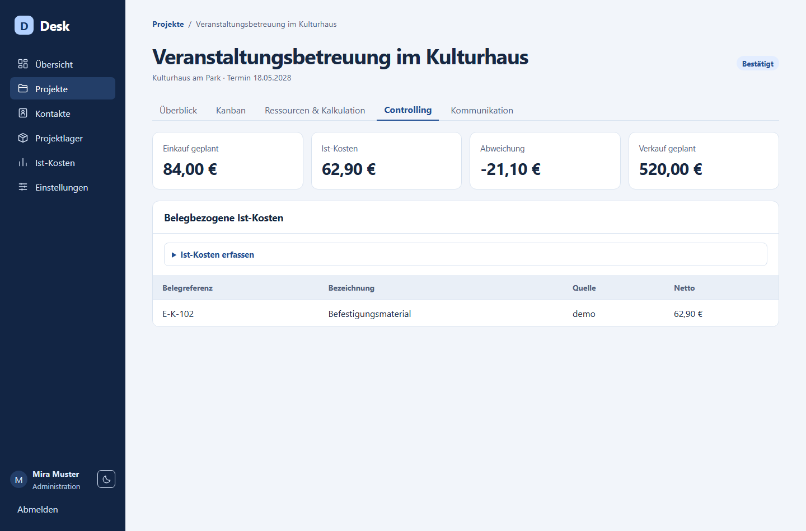

# Desk verwenden und betreiben

## Ein Auftrag

1. Einen Kontakt und ein Projekt anlegen. Aufgaben im Kanban verteilen und den Projektstatus auf Planung setzen.
2. Personal und Inventar vormerken. Geplante Einkaufskosten und Verkaufspositionen erfassen. Die Verkaufspositionen können als CSV exportiert werden. Beim Entfernen einer Kalkulationsposition zeigt Desk ihren Namen zur Bestätigung.
3. Eine Angebotsreferenz ergänzen. Bei eingerichteter Haben-Verbindung die ID des vorhandenen Angebots eintragen und abgleichen. Desk zeigt den Status des Angebots an und kann die Bestätigung übernehmen. Ohne Haben wird der Projektstatus von Hand gesetzt.
4. Nach der Bestätigung Ressourcen fest reservieren. Personen können sich in festen Reservierungen zeitlich nicht überschneiden. Bei Geräten prüft Desk die am Lagerort verfügbare Menge im gewählten Zeitraum, bei Verbrauchsmaterial alle festen Reservierungen am Lagerort. Eine Freigabe gibt die reservierte Menge frei. Die Reservierung bleibt mit dem Status „Freigegeben“ sichtbar. Bereits ausgegebene Geräte bleiben bis zur Rückgabe sichtbar.
5. Im Projektlager Wareneingang erfassen. Das Team kann fest reservierte Geräte im gebuchten Zeitfenster ausgeben und später zurücknehmen. Bei einer festen Reservierung kann es Verbrauchsmaterial ausbuchen. Die Bestandsübersicht zeigt bei Geräten die aktuell geltenden festen Reservierungen und bei Verbrauchsmaterial alle offenen festen Reservierungen. Unter **Offene Ausgaben** kannst du nach Projekt und Lagerort filtern. Nach einer Teilrückgabe steht dort die verbleibende Menge. Die Tabelle **Lagerbewegungen** zeigt den Lagerort jeder Buchung.
6. Ist-Kosten importieren oder per Belegreferenz zuordnen. Im Controlling stehen Netto-Plan- und Ist-Kosten nebeneinander. Den Auftrag über „In Durchführung“ fortsetzen. Die in Haben oder einem anderen System erstellte Rechnung im Projekt referenzieren und den Projektstatus auf „Abgerechnet“ setzen.

Unter **Kontakte → Kontakt anlegen** prüft Desk beim Speichern, ob der Name oder die ausgefüllte E-Mail-Adresse mit einem vorhandenen Kontakt übereinstimmt. Äußere Leerzeichen und Groß- oder Kleinschreibung spielen beim Vergleich keine Rolle. Öffne einen Treffer aus der Liste oder wähle **Trotzdem anlegen** und bestätige den zusätzlichen Kontakt. **Abbrechen** erhält die Eingabe und die Trefferliste.

Wähle unter **Kontakte** den Namen eines Kontakts. Unter **Zugehörige Projekte** stehen seine Projekte mit Status und Termin. Wähle den Projektnamen, um das Projekt zu öffnen. Gleichnamige Kontakte zeigen jeweils ihre eigenen Projekte.

Wenn Desk meldet, dass eine Änderung gespeichert wurde und die Ansicht nicht aktualisiert werden konnte, wähle **Ansicht aktualisieren**. Desk ruft die Daten erneut ab. Der Schreibvorgang wird dabei nicht wiederholt. Ist deine Sitzung abgelaufen, meldet Desk die erfolgreiche Speicherung in der Anmeldemaske. Nach der Anmeldung lädt Desk die aktuelle Ansicht.

In der Ressourcenplanung und im Projektlager steht die Inventarnummer eines Einzelgeräts neben seinem Namen. Unter **Ausgabe, Rückgabe oder Verbrauch** zeigt Desk nach der Wahl der **Projektreservierung** die vollständige Beschreibung mit Inventarnummer im Formular. Bei Artikeln ohne Inventarnummer zeigt Desk den Artikelnamen.

### Wochenplanung öffnen

Unter **Wochenplanung** siehst du offene Reservierungen aus allen Projekten. Wähle ein Datum oder blättere wochenweise. Eine Woche reicht von Montag 00:00 Uhr bis zum folgenden Montag 00:00 Uhr in der angezeigten Browser-Zeitzone. Personal steht je Person, Inventar je Artikel und Lagerort mit Menge. **Vorgemerkt** und **Fest reserviert** sind direkt am Eintrag beschriftet. Eine Buchung über Mitternacht erscheint an beiden betroffenen Tagen, beim Wochenwechsel jeweils in der zugehörigen Woche. Am Tag der Herbstumstellung machen UTC-Offsets die wiederholte Stunde unterscheidbar. Offene Geräteausgaben findest du im **Projektlager**.

Wähle den Projektnamen im Eintrag, um den Projektüberblick zu öffnen. Zum Bearbeiten der Reservierung wechsle dort zu **Ressourcen & Kalkulation**.

Für denselben Datensatz liefert `GET /api/v1/planning/reservations` die offenen Reservierungen für ein angegebenes Zeitfenster projektübergreifend. Übergib `from` und `to` als ISO-Zeitstempel mit Zeitzone für die Jahre 0001 bis 9999 und mit bis zu sechs Nachkommastellen. UTC-Offsets von −15:59 bis +15:59 sind möglich. `to` muss nach `from` liegen. Die Antwort enthält Buchungen, die vor `to` beginnen und nach `from` enden. `limit` und `offset` ermöglichen die Seitennavigation.

### Projektverlauf ansehen

Öffne im Projekt **Verlauf**. Desk zeigt Statuswechsel, feste Reservierungen, Freigaben und projektbezogene Lagerbewegungen. Die neuesten Ereignisse stehen oben. Die Ansicht nennt Zeitpunkt und ausführende Person, soweit sie gespeichert sind. Statuswechsel durch den Haben-Angebotsabgleich und automatische Freigaben beim Wechsel auf **Abgesagt** oder **Abgerechnet** sind gekennzeichnet.

Desk zeichnet Statuswechsel, Festlegungen und Freigaben ab Migration `007_project_history.sql` auf. Vorhandene projektbezogene Lagerbewegungen erscheinen mit ihren ursprünglichen Buchungszeiten. Führe die Migration mit dem Befehl für deinen Installationsweg aus, bevor du die neue Version startest.

Über die API liefert `GET /api/v1/projects/{id}/history` denselben Verlauf. Mit `limit` und `offset` kannst du seitenweise lesen. Im Feld `source` kennzeichnet `haben` den manuellen Haben-Abgleich und `project` die automatische Freigabe durch Statuswechsel. `desk` steht für die übrigen Ereignisse.

### Lagerbuchung korrigieren

Öffne **Projektlager → Lagerbewegungen** und wähle beim ursprünglichen Wareneingang oder Verbrauch **Korrigieren**. Gib Menge und Begründung ein und wähle **Korrektur buchen**. Desk zeigt den ursprünglichen Eintrag sowie die neue Bewegung mit Begründung und Link zum Original. Teilkorrekturen können zusammen höchstens die ursprüngliche Menge erreichen. Für eine Ausgabe verwendest du die Rückgabe.

Eine Verbrauchskorrektur schreibt die Menge dem Lagerort gut. Bei fester Reservierung steht die korrigierte Menge wieder für diese Reservierung bereit. Bei einer Korrektur des Wareneingangs prüft Desk den physischen Bestand. Für Geräte zählt die höchste gleichzeitige Restmenge aus laufenden und zukünftigen festen Reservierungen. Für Verbrauchsmaterial zählt der offene Bedarf aller festen Reservierungen. Ein vollständig zurückgenommener Wareneingang eines Einzelgeräts lässt sich anschließend neu buchen.

War die Antwort auf eine bereits gespeicherte Vollkorrektur unklar, öffne an der Originalbuchung **Korrektur prüfen** und wähle **Letzten Vorgang erneut senden**. Desk zeigt das Ergebnis der ursprünglichen Buchung.

### Bestand filtern

Unter **Bestand je Lagerort** sucht **Bestand suchen** nach Teilen des Artikelnamens, der Artikelnummer oder der Inventarnummer. Groß- und Kleinschreibung spielen dabei keine Rolle. Eine Bestandszeile muss alle aktiven Filter erfüllen. **Nur mit freiem Bestand** zeigt Zeilen mit einem Wert größer als null in der Spalte **Frei**. Ergibt die Filterung keine Treffer, erscheint „Kein Bestand für diese Filter.“ **Filter zurücksetzen** leert Suche und Lagerortwahl und deaktiviert die Option. **Offene Ausgaben** und **Lagerbewegungen** bleiben separat sichtbar.

## Haben

`HABEN_URL` und `HABEN_TOKEN` auf dem Desk-Server setzen. Angebote benötigen Leserechte für Angebote. Für Kontakte stehen die benötigten Rechte, der erste Import, das Verknüpfen und die Wiederholung nach Fehlern im [Kontaktabgleich zwischen Desk und Haben](haben-kontaktabgleich.md).

Desk legt Angebote in der ersten Version über die manuelle Übergabe an Haben an. Der Abgleich verwendet die unterstützte Lese-API. Bei Belegkosten unterstützt Desk die Einzelzuordnung oder einen vorbereiteten CSV-Export. Pro Zeile sind `reference`, `name` und der Nettobetrag in `amount` erforderlich. `cost_center` ist optional. Verwende eine stabile Referenz je Belegzeile. Der Import erkennt die Kombination aus Quelle und Referenz wieder und zeigt fehlende Projektzuordnungen unter Ist-Kosten.

## Zammad

`ZAMMAD_URL`, `ZAMMAD_TOKEN` und die Ticketgruppe `ZAMMAD_GROUP` setzen. Der Zammad-Zugang benötigt für die Gruppe die passenden Agentenrechte. Desk verwendet das Ticket für den Nachrichtenverlauf und die Übergabe ausgehender Antworten. Der Versand bleibt in Zammad nachvollziehbar. PDF-Anhänge sind bis 5 MB möglich. Ohne Zammad sind Kommunikationslink und Notiz im Projekt verfügbar.

Im Ticketverlauf kennzeichnet Desk ein- und ausgehende E-Mails sowie interne Einträge. Wenn Desk die Art des Eintrags nicht erkennen kann, steht dort **Art unbekannt**. Bei einer externen eingehenden E-Mail mit gültiger Nachrichtenkennung und eindeutiger Adresse öffnet **Antworten** den Editor. Desk verwendet Reply-To, wenn das Feld einen Wert enthält. Andernfalls prüft Desk die Absenderadresse. Bei einer ungültigen oder mehrdeutigen Adresse bleibt die Nachricht lesbar. Der Editor zeigt den Empfänger und den bearbeitbaren Entwurfsbetreff. Den tatsächlichen Versandbetreff formatiert Zammad nach seiner Konfiguration. Zum eigenständigen Versand öffnest du **Antwort schreiben** und trägst den Empfänger ein.

Bei einem unklaren Versand wählst du unter **Kommunikation → Zammad** beim gespeicherten Sendeversuch **Prüfen**. **Erneut senden** zeigt den Betreff zur Bestätigung. Desk sucht vor einer erneuten Sendung nach der Referenz des Versuchs im Ticketverlauf. Bleibt der Ausgang unklar oder wird der Versuch abgelehnt, steht die Meldung im Dialog. Nach **Schließen** kannst du einen weiteren Versuch ausdrücklich bestätigen.

Solange Desk auf Klarheit über den Sendeversuch wartet, bleiben die übermittelten Angaben im geöffneten Editor gesperrt. Wenn Desk keine Bestätigung erhalten hat und keinen gespeicherten Versuch anzeigt, übergibt **Mit denselben Angaben fortfahren** den Entwurf unverändert erneut an Desk. Nach einer bestätigten Ablehnung lässt sich über **Neuen Entwurf beginnen** eine bearbeitbare Nachricht vorbereiten. Hat sich die Antwortadresse geändert, lade den Verlauf neu und bestätige die aktualisierte Adresse über **Adresse … übernehmen**. Der Entwurf bleibt dabei erhalten.

Wende Migration `008_zammad_reply.sql` vor dem Start an, wie unter [Betrieb](#betrieb) beschrieben. Desk speichert damit bei neuen artikelbezogenen Sendeversuchen die Nachrichtenkennung. Bereits gespeicherte Versuche bleiben erhalten. Ältere Desk-Stände verwenden beim Versand die gespeicherte Antwortreferenz nicht. Kläre offene artikelbezogene Versuche vor einem Rückwechsel oder wiederhole sie nach der Rückkehr auf einen Stand mit diesem Versandverhalten.

Nach der Einrichtung oder einem Tokenwechsel in den administrativen Einstellungen unter „Integrationen“ die interne ID eines vorhandenen Zammad-Testtickets eintragen und „Zammad-Verbindung prüfen“ wählen. Die interne ID steht im Zammad-Ticketlink und kann von der sichtbaren Ticketnummer abweichen. Desk prüft den Lesezugriff auf das Ticket und seinen Verlauf. [Zammad-Ticket-API](https://docs.zammad.org/en/latest/api/ticket/index.html#show)

Unter **Kommunikation → Zammad** kannst du die Ticketverknüpfung vor dem ersten in Desk gespeicherten Sendeversuch für dieses Ticket lösen. Wähle **Ticketverknüpfung lösen** und bestätige die angezeigte Ticket-ID. Ticket und Verlauf bleiben in Zammad erhalten. Desk behält den Vorgangslink und die Kommunikationsnotiz des Projekts. Danach kannst du wieder ein Ticket verknüpfen. Sobald ein Desk-Sendeversuch für das verknüpfte Ticket gespeichert ist, antwortet die REST-API beim Lösen oder Wechseln der Verknüpfung mit HTTP 409.

Bei einem verknüpften Ticket filtert **Ticketverlauf durchsuchen** die bereits geladenen Nachrichten nach Betreff und Text. Bei Treffern zeigt Desk, wie viele der geladenen Nachrichten passen. Ein vorhandener Antwortentwurf bleibt beim Suchen erhalten.

## Betrieb

- Je nach Ticketbetrieb stehen drei Installationswege zur Auswahl. [Installationsplan mit und ohne Zammad](installation.md)
- Für den Start aus dem Quellcheckout `bun run build`, `bun run migrate` und `bun run start` ausführen. Beim Docker-Image die Migration vor dem Dienststart über einen einmaligen Container aus dem neuen Image ausführen. Verwende dafür `bun scripts/migrate.ts`, dieselbe `DATABASE_URL` und denselben Netzwerkzugang zu PostgreSQL wie für den Dienst.
- `DESK_ORIGIN` auf die externe HTTPS-Adresse setzen und `DESK_AUTH_SECRET` dauerhaft im Anwendungsprozess beziehungsweise im Docker-Dienst bereitstellen. Den Dienst hinter einem HTTPS-Reverse-Proxy betreiben. Für eine Demo eine separate Datenbank mit dem Suffix `_demo` verwenden.
- Teamkonten und widerrufbare API-Tokens stehen in den Einstellungen. Der API-Vertrag ist unter `/api/v1/openapi.json` verfügbar. Schreibende Tickets, Kontakte und andere Vorgänge laufen über die jeweils eingerichteten Serverzugänge.
- Bei `POST /api/v1/movements`, `POST /api/v1/movements/{id}/corrections` und `POST /api/v1/reservations` kann ein optionaler `Idempotency-Key` übermittelt werden. Bei unklarer Antwort denselben Schlüssel und dieselben Angaben vom selben Konto erneut an denselben Endpunkt senden. Desk gibt die ursprüngliche Buchung, Korrektur oder Vormerkung mit HTTP 201 zurück. Andere Angaben zum selben Schlüssel ergeben HTTP 409. Zeitangaben mit verschiedenen UTC-Offsets gelten als gleich, wenn sie denselben Zeitpunkt bezeichnen. Für einen neuen Vorgang einen neuen Schlüssel verwenden. Ohne Schlüssel behandelt Desk jeden Aufruf als eigenen Vorgang.
- Bei offenen Lagerbuchungen und Vormerkungen behält die Oberfläche den Vorgang im Browser-Tab über das Neuladen hinweg. Bei unklarer Antwort im selben Formular „Letzten Vorgang erneut senden“ wählen. Bei Vormerkungen bleiben die ursprünglich bestätigten Zeitpunkte auch nach einem Wechsel der Browser-Zeitzone erhalten. „Neuen Vorgang beginnen“ startet einen separaten Vorgang.
- Vor einem Update PostgreSQL sichern und die Wiederherstellung in einer getrennten Instanz prüfen. [PostgreSQL sichern und Wiederherstellung prüfen](sicherung.md)
- Für Desktop und Smartphone dieselbe HTTPS-Adresse verwenden.
- `curl -i http://127.0.0.1:3000/api/v1/ready` prüft die Bereitschaft ohne Anmeldung. Desk antwortet mit HTTP 200 und `{"ready":true}`, wenn PostgreSQL erreichbar ist und alle vom Build erwarteten Migrationen angewendet wurden. Bei fehlender Migration, einem Datenbankfehler oder nach Ablauf des Zeitbudgets von zwei Sekunden lautet die Antwort HTTP 503 mit `{"ready":false}`. Fehlt `DATABASE_URL`, bricht der Start ab. Wende nötige Migrationen vor dem Dienststart an. Verwende bei Bedarf einen anderen Port. Die Prüfung ist unabhängig von Haben und Zammad.
- Vor der ersten Veröffentlichung den vorgesehenen Stand mit dem [Prüfleitfaden zur Release-Abnahme](release-abnahme.md) protokollieren.

### Update für Lagerkorrekturen

Wende `006_stock_corrections.sql` vor dem Start der neuen Version mit dem unter [Betrieb](#betrieb) beschriebenen Migrationsbefehl an. Vorhandene Lagerbewegungen bleiben erhalten. Sobald die Datenbank Korrekturbuchungen enthält, verwende mit dieser Datenbank eine Desk-Version mit Unterstützung für Lagerkorrekturen. Für einen Rückweg auf einen älteren Stand stelle eine Sicherung von vor der ersten Korrektur wieder her. Die Wiederherstellung setzt auch andere Änderungen seit der Sicherung zurück.

### Update auf Better Auth

Vor dem Update den bisherigen Desk-Dienst anhalten. PostgreSQL sichern und die Wiederherstellung in einer getrennten Instanz prüfen. Für den neuen Dienst `DESK_AUTH_SECRET` als dauerhaftes Secret setzen. Einen zufälligen Wert erzeugt `bun -e "console.log(require('node:crypto').randomBytes(32).toString('base64url'))"`. Rechte auf die Ausgabe beschränken. `DESK_ORIGIN` muss zur aufgerufenen Adresse passen.

Wende die Migrationen vor dem Start der neuen Version mit dem oben beschriebenen Befehl für deinen Installationsweg an. Die Migration `002_better_auth.sql` übernimmt vorhandene Passwort-Hashes und stellt Better Auth die Konten über `auth_users` bereit. Die UUIDs, Rollen, Zuordnungen und API-Tokens bleiben erhalten. Das Team meldet sich nach dem Update einmal neu an. Eine Sitzung läuft nach zwölf Stunden ab. Konten legt die Administration in Desk an. Die CLI verwendet im Quellcheckout `bun run admin` und im Runtime-Image `bun scripts/admin.ts`.

Für jeden Versionswechsel nach bereits erfolgter Migration den gerade laufenden Desk-Dienst anhalten. Danach die Sitzungen beider Versionen in der aktiven Desk-Datenbank widerrufen und erst nach erfolgreicher Ausführung die Zielversion starten.

```sql
BEGIN;
DELETE FROM auth_sessions;
DELETE FROM sessions;
COMMIT;
```

Danach das vorherige Anwendungsimage mit derselben Datenbank starten oder den neuen Dienst erneut ausrollen. Das Team meldet sich nach jedem Versionswechsel neu an. Die aktuellen Passwort-Hashes und die seit dem Update geschriebenen Geschäftsdaten bleiben erhalten. Ein älteres Komplettbackup stellt den Stand zum Sicherungszeitpunkt wieder her. Vor dem Freigeben einer wiederhergestellten Datenbank alle dort vorhandenen Desk-Sitzungstabellen leeren. Vor Migration 002 ist das `sessions`. Nach Migration 002 sind es `sessions` und `auth_sessions`.

### Eigenes Passwort ändern

Unter **Mein Konto → Passwort ändern** bestätigen Mitarbeitende und Administration ihr aktuelles Passwort und wählen ein anderes mit 12 bis 200 Zeichen. Der Wechsel ist nach der Erstanmeldung freiwillig. Bei einer neuen Anmeldung gilt das neue Passwort. Mit **Andere Browsersitzungen beenden** meldet Desk die übrigen Browser dieses Kontos ab. Die aktuelle Sitzung bleibt aktiv. Passkeys und API-Tokens behalten ihre Gültigkeit.

Desk aktualisiert bei einem Wechsel auch den Passwort-Hash für einen möglichen Anwendungs-Rollback. Eine zusätzliche Datenbankmigration ist dafür nicht erforderlich.

### Passkeys

Unter **Mein Konto → Passkeys** können Mitarbeitende und Administration eigene Passkeys benennen und einrichten. Auf der Anmeldeseite startet **Mit Passkey anmelden** die Freigabe im Browser. Desk benötigt einen Passkey, den der Browser ohne Eingabe der E-Mail-Adresse finden kann und den das Gerät etwa per PIN oder Biometrie bestätigt. Das bestehende Passwort kann weiterhin verwendet werden. Beim Entfernen eines Passkeys endet seine Verwendung in Desk. Der Browser oder Passwortmanager kann den lokalen Eintrag weiterhin anzeigen.

Passkeys gelten für den Host in `DESK_ORIGIN`. In Produktion ist eine HTTPS-Adresse erforderlich, für lokale Tests unterstützt der Browser `http://localhost`. Bei einem Wechsel auf einen anderen Host richten Mitarbeitende ihre Passkeys dort neu ein. Anmeldungen mit bestehenden Passwörtern bleiben möglich.

Wende `004_passkeys.sql` vor dem Start der neuen Version mit dem unter [Betrieb](#betrieb) beschriebenen Migrationsbefehl für deinen Installationsweg an.

### Teamkonten sperren und freigeben

Unter **Einstellungen → Team** kann die Administration ein Konto sperren. Desk widerruft dabei alle vorhandenen Sitzungen und API-Tokens dieses Kontos. Während der Sperre lehnt Desk Anmeldungen per Passwort und Passkey ab. Nach der Freigabe kann sich die Person mit dem bisherigen Passwort oder Passkey neu anmelden. API-Tokens müssen neu ausgestellt werden. Mindestens ein Administrationskonto bleibt aktiv.

Der Name bleibt bei vorhandenen Aufgaben und Reservierungen sichtbar. Eine Aufgabe lässt sich mit ihrer bisherigen Zuordnung weiter bearbeiten. Bei neuen Zuordnungen und Vormerkungen zeigt Desk nur aktive Konten an. Eine bestehende vorläufige Reservierung lässt sich freigeben. Verbindlich buchen lässt sie sich wieder nach Freigabe des Kontos.

Wende `005_team_access.sql` vor dem Start der neuen Version wie unter [Betrieb](#betrieb) beschrieben an. Vorhandene Konten und ihre Zuordnungen bleiben erhalten. Die Migration übernimmt vorhandene Konten zunächst als aktiv.

Bei einem Rückweg auf einen Desk-Stand vor der Kontensperre bleibt der gespeicherte Kontostatus erhalten. Die frühere Oberfläche bietet bei Aufgaben und Personalvormerkungen wieder alle Teamkonten an. Der frühere Dienst akzeptiert diese Zuordnungen.

### Desk-Stand für Fehlerberichte

Unter **Mein Konto → Desk-Version** lässt sich die Programmversion mit dem Git-Commit kopieren. Am Smartphone öffnest du **Mein Konto** über das Menü. Die angezeigte Desk-Programmversion stammt aus `deskVersion` in `package.json`. Das Feld `version` gibt die dreiteilige Version des internen Pakets an. Stelle den vollständigen Commit beim Bau des ausgecheckten Stands bereit.

```sh
build_commit="$(git rev-parse --verify HEAD)" &&
  DESK_BUILD_COMMIT="$build_commit" bun run build
build_commit="$(git rev-parse --verify HEAD)" &&
  docker build --build-arg "DESK_BUILD_COMMIT=$build_commit" -t desk:lokal .
```

Für Docker Compose steht der Aufruf im [Installationsleitfaden](installation.md#eigenständiger-start-mit-docker-compose). Starte anschließend den gebauten Dienst und vergleiche die unter **Desk-Version** angezeigte Angabe mit `git rev-parse HEAD`. Die Angabe bleibt bei einem Neustart desselben Builds erhalten. Ein Build ohne Commit-Angabe zeigt **Stand unbekannt**.

### Quellcode für den ausgelieferten Stand

Stelle den Quellcode des ausgelieferten Desk-Stands unter einer dauerhaften HTTPS-Adresse ohne Anmeldung bereit. Gib diese Adresse beim Bau als `DESK_SOURCE_URL` an. Beim Build aus dem Checkout ist das eine Umgebungsvariable. Bei Docker übergibst du sie mit `--build-arg "DESK_SOURCE_URL=$source_url"`. Bei Compose setzt du den Wert in `.env.selfhost` vor dem [Bau des Desk-Images](installation.md#eigenständiger-start-mit-docker-compose).

Mit gesetzter Adresse erscheint **Desk-Quellcode** auf der Anmeldeseite und unter **Mein Konto → Desk-Version**. Ohne die Angabe bleibt der Link ausgeblendet. Die Adresse gehört zum Build. Prüfe vor der Auslieferung, dass der verlinkte Quellstand der angezeigten Commit-ID entspricht und sich ohne Anmeldung abrufen lässt.

### Rollback einer fehlgeschlagenen Migration prüfen

Führe `bun scripts/rehearse-migration-rollback.ts` im Git-Checkout aus. Die Probe verwendet eine eigene PostgreSQL-Instanz und ein Docker-Image aus einer temporären Kopie des ausgecheckten Commits. Benötigt werden Git, tar, die in `package.json` angegebene Bun-Version und ein Docker-Kontext, der lokale Verzeichnisse einbinden und einen lokalen Loopback-Port bereitstellen kann. Der freie Port ist standardmäßig 4182. Über `DESK_ROLLBACK_TEST_PORT` lässt sich ein anderer Port wählen.

Die Probe ergänzt ausschließlich in der temporären Kopie zwei SQL-Dateien. Nach einem Fehler in der zweiten Datei prüft sie beide Testtabellen, das Migrationsprotokoll, den Bereitschaftsstatus und ein bereits gespeichertes Musterprojekt. Nach der Korrektur derselben Testdatei werden die Migrationen auf derselben Testdatenbank angewendet und alle vier Ergebnisse erneut geprüft. Kann die Probe ihre Testressourcen nicht vollständig entfernen, meldet sie die betroffenen Ressourcen und endet mit einem Fehlerstatus.

### Seitennavigation der REST-API

`limit` bestimmt die Höchstzahl der Einträge pro Seite (1 bis 200, Standard 100). `offset` überspringt Einträge am Anfang der aktuellen sortierten Liste (0 bis 1.000.000, Standard 0). Diese Parameter gelten für die folgenden GET-Listen:

| Routen unter `/api/v1` | Reihenfolge |
| --- | --- |
| `/contacts`, `/projects`, `/tasks`, `/locations`, `/items` | Name, ID |
| `/lines` | Art, Name, ID |
| `/reservations` | Startzeit, bei gleichem Start Personal vor Geräten und Material, ID |
| `/planning/reservations` | Startzeit, ID |
| `/projects/{id}/history` | Zeitpunkt absteigend, Ereignisart, ID |
| `/movements` | Zeitpunkt absteigend, ID |
| `/costs` | Nicht zugeordnete Kosten zuerst, Name, ID |

Für die Projektliste des fiktiven Muster Auftragsservice öffnet `GET /api/v1/projects?limit=100&offset=0` die ersten 100 Projekte. `GET /api/v1/projects?limit=100&offset=100` liest die nächste Seite, etwa ab „Musterauftrag 101“, wenn die synthetischen Projekte entsprechend benannt sind. Erhöhe den Offset nach jeder vollen Seite um das Limit. Eine kürzere oder leere Seite beendet die Abfrage. Liegt der nächste Offset über 1.000.000, endet der Abruf möglicherweise vor dem Listenende. Änderungen zwischen den Abfragen können Einträge verschieben und dadurch doppelt erscheinen oder übersprungen werden.

## Ansichten

<picture>
  <source media="(prefers-color-scheme: dark)" srcset="screenshots/controlling-dunkel.png">
  
</picture>

[Projektlager auf dem Smartphone, hell](screenshots/projektlager-hell-handy.png) · [Projektlager auf dem Smartphone, dunkel](screenshots/projektlager-dunkel-handy.png)

## Navigation am Smartphone

Die Kopfleiste zeigt **Menü**. Dahinter liegen die Hauptnavigation, Hell- und Dunkelmodus sowie der Kontobereich. Nach Auswahl eines Bereichs schließt das Menü und der Tastaturfokus wechselt zum Hauptinhalt. Escape schließt es und bringt den Tastaturfokus zurück zum Schalter.

<picture>
  <source media="(prefers-color-scheme: dark)" srcset="screenshots/navigation-dunkel-handy-offen.png">
  
</picture>
